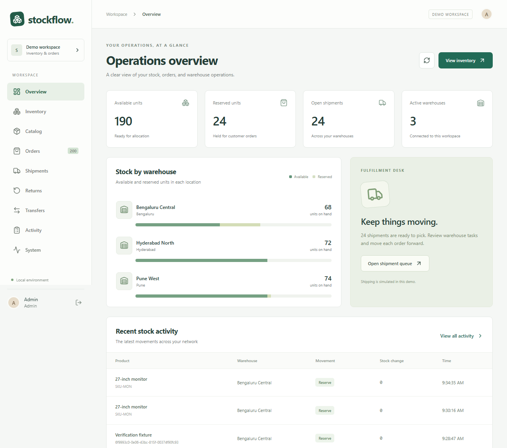

# Stockflow — Distributed Inventory & Order Management Platform

A Java 21 / Spring Boot / React project for a business with multiple warehouses. It includes stock reservations, split orders, warehouse fulfillment, simulated shipping, partial returns, transfers, and failure recovery. Everything runs locally without paid APIs or subscriptions.



## Start here

Install Docker Desktop (Linux containers). On Windows, open PowerShell 7 in this project folder:

```powershell
./scripts/setup.ps1
./scripts/start.ps1 -Mode lite
```

Open **http://localhost:8088**. Initial image downloads and builds can take several minutes.

| Account | Email | Initial local password |
|---|---|---|
| Administrator | admin@stockflow.local | StockflowDemo2026! |
| Bengaluru operator | operator@stockflow.local | StockflowDemo2026! |
| Customer | customer@stockflow.local | StockflowDemo2026! |

The setup script creates `.env` only if it does not exist. If you changed `DEMO_PASSWORD`, use that value. Password changes do not overwrite users already stored in a database. New customers can register in the UI.

This password is deliberately a documented **local demo credential**. Database and JWT secrets are generated separately. All published ports bind to localhost. Shipping, refunds, customer data, and emails are simulations. No payment is collected.

## Run the distributed version

```powershell
./scripts/start.ps1 -Mode distributed
```

Open **http://localhost:8089**. This runs six independently addressable Spring processes, PostgreSQL databases with separate owners, Redis, Kafka, the web gateway, and Mailpit. The services share one build artifact and are selected by `APP_ROLE`; they are not six independently versioned repositories. See [architecture](docs/ARCHITECTURE.md) for the tradeoff.

Lite and distributed modes use separate databases. Data is not automatically migrated between them. Stop unused containers to conserve memory:

```powershell
./scripts/stop.ps1
```

This preserves database volumes. Avoid `docker compose down -v` unless you deliberately want to destroy this project's stored data.

## Review the project

1. Sign in as customer, open Catalog, add products, and place a demo order.
2. Watch Orders move from pending stock to fulfillment. Open its details for the timeline.
3. Sign in as admin. Open Shipments, then pick, pack, dispatch, mark in transit, and deliver.
4. Request a return from a delivered shipment. Approve, receive, and inspect it as admin.
5. Use Inventory to receive or adjust stock. Use Transfers to dispatch and receive stock between warehouses.
6. Open Activity for the ledger and System for event delivery and reconciliation.
7. Sign in as operator to verify that warehouse actions are limited to Bengaluru.

To demonstrate splitting, order more than any one warehouse can supply, but no more than the combined available stock. Seed data begins with 8 units per product in Bengaluru and 12 each in Hyderabad and Pune.

## Services and local links

| Component | Address |
|---|---|
| Lite web | http://localhost:8088 |
| Distributed web | http://localhost:8089 |
| Mailpit, local email inbox | http://localhost:8025 |
| Prometheus, optional | http://localhost:9090 |
| Grafana, optional | http://localhost:3001 |
| PostgreSQL, local tools | localhost:55432 |
| Native backend, development only | http://localhost:18080 |
| Native React development server | http://localhost:5173 |

Enable monitoring with `./scripts/start.ps1 -Mode distributed -Monitoring`. Grafana username is `admin`, password is `GRAFANA_PASSWORD` in `.env`. The provisioned dashboard shows JVM memory, request rates, and event backlogs. Prometheus lists inactive mode targets as down; this is expected when only one mode runs.

## Development without rebuilding containers

Use JDK 21, Maven 3.9+, and Node 24. Docker still provides PostgreSQL and Mailpit.

```powershell
docker compose up -d postgres mailpit
./backend/mvnw.cmd -f backend/pom.xml -DskipTests package
./scripts/run-backend.ps1
# In another terminal:
npm --prefix frontend ci
npm --prefix frontend run dev
```

If `JAVA_HOME` points to a nonexistent folder, point the current terminal to the actual JDK root. Do not include a second `jdk-21` subfolder. You can also pass the full Java executable path to `scripts/run-backend.ps1 -Java`.

The folder name contains `&`; quote absolute paths in shell commands. Frontend scripts invoke Node entry points directly to avoid Windows command-shim path parsing issues.

## Verification

```powershell
./scripts/test.ps1 -Maven ./backend/mvnw.cmd
# With a local web instance running:
npm --prefix frontend run test:e2e
# For distributed HTTP/concurrency/recovery tests:
$env:BASE_URL='http://localhost:8089'
$env:RECOVERY='true'
node tests/system.mjs
```

Backend tests use a **separate database whose name must end in `_test`**. They reset that test database's business tables. System/browser tests create synthetic records in the running demo. Recovery tests stop and restart only this project's Redis, inventory, and Kafka containers. Do not run those against a deployment someone else is using.

See [verification results](docs/VERIFICATION.md), [learning guide](docs/LEARNING_GUIDE.md), [runbooks](docs/RUNBOOKS.md), and [scope and limitations](docs/LIMITATIONS.md).

## Repository map

- `backend/src/main/java/dev/stockflow`: domain APIs, transactions, authentication, messaging.
- `backend/src/main/resources/db`: service-owned Flyway migrations and the combined lite migration set.
- `frontend/src`: React workspace, customer ordering, API session handling, responsive styles.
- `infra`: PostgreSQL initialization, Nginx routing, monitoring configuration.
- `tests`: real HTTP system verification and optional k6 workload.
- `scripts`: setup, startup, test, backup, and isolated restore helpers.
- `contracts`: API and event contracts.
- `docs`: architecture, decisions, learning sequence, operational procedures, evidence.

The application uses Spring JDBC with explicit SQL rather than JPA. Row locking, conditional updates, and transaction boundaries are intentionally visible for learning. There is no paid API, cloud account, or remote payment/courier dependency.
