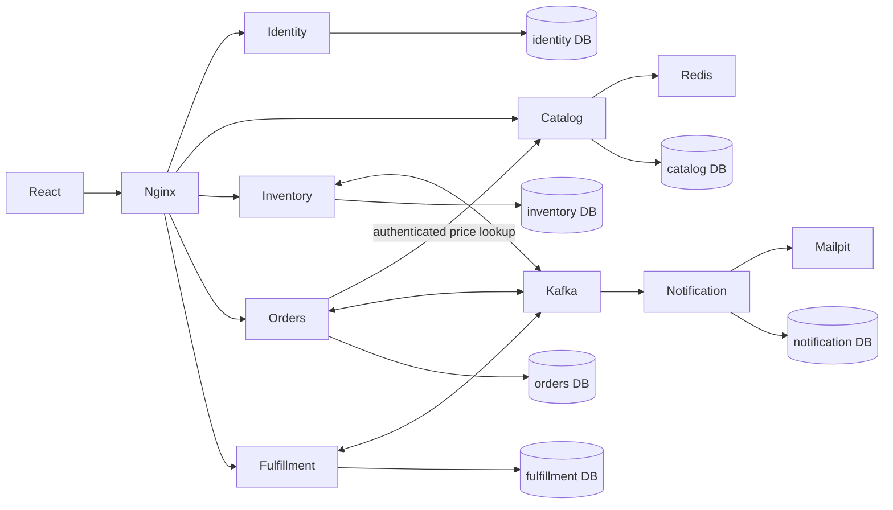
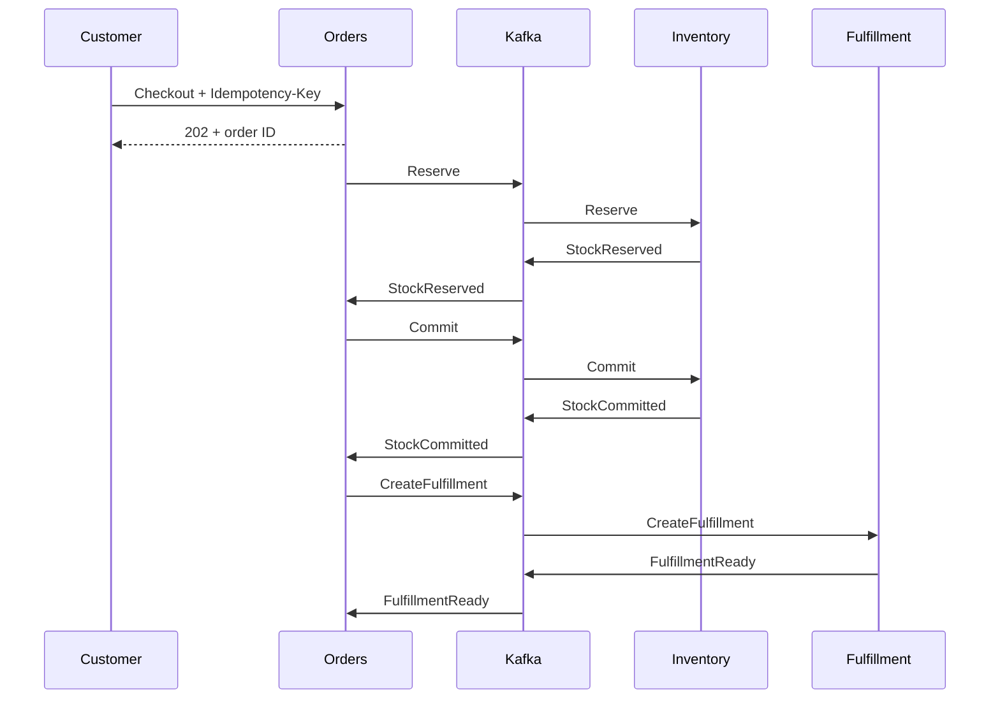

# Architecture and correctness

## Execution modes

`APP_ROLE=all` loads every domain into one Spring process and one database. Its outbox delivers through a transactional local dispatcher. `APP_ROLE=identity|catalog|inventory|orders|fulfillment|notification` loads only that domain. Each distributed process has a distinct database owner and Kafka consumer group. No service queries another service's database.

One PostgreSQL server hosts these databases to reduce local resource use. Separate ownership enforces the logical boundary, but the server is still a shared availability dependency. All services share one Maven build and container image; extraction is by runtime role, not independent release management.

## Inventory

Sellable physical stock is `on_hand`. `reserved` includes active checkout holds and committed unshipped allocations. `available = on_hand - reserved`. Damaged returns are counted separately. Database constraints reject negative stock and reservations above on-hand quantities.

Allocation locks requested SKU balances across candidate warehouses in a consistent warehouse/SKU order. It prefers one warehouse that can satisfy every line, otherwise splits by configured priority. It validates the entire allocation before writing any line. Stock updates, reservation rows, ledger entries, and outgoing events commit atomically. Locking spans multiple service instances because it happens in PostgreSQL.

Receipts add on-hand units. Reservations add reserved units. Release subtracts reserved units. Dispatch subtracts both. Sellable return inspection adds on-hand units; damaged inspection adds damaged units. Transfers subtract source stock at dispatch and add destination stock on receipt. Their quantities remain unavailable while in transit.

`stock_movements` is append-only. A database trigger rejects updates and deletes. Corrections are new movements. The reconciliation endpoint compares all three balance fields with ledger deltas and reports mismatches.

## Durable order saga

The customer/key pair is serialized with a PostgreSQL transaction advisory lock. A repeated identical checkout returns the existing order; a changed request with the same key returns conflict. Price, product name, address, and currency are recorded on the order; checkout ignores client prices.

Active reservations expire after a configurable duration. Confirmation locks the reservation and checks the database clock. Committed reservations do not expire. A cancellation first asks fulfillment to stop. Fulfillment serializes cancellation and dispatch on its order row; once dispatch is pending, cancellation is refused. Only after fulfillment cancellation is acknowledged does inventory release the hold. Cancellation tombstones reject delayed creation commands.

Dispatch is asynchronous: `PACKED → DISPATCH_PENDING`, then inventory consumes the allocation, then fulfillment records `DISPATCHED`. Shipment progress is monotonic at order level. Returns serialize allowance checks on the shipment and exclude rejected requests from consumed allowance. Restocking has a durable unique operation key.

## Event delivery

Each database contains an outbox and an inbox (`processed_messages`). Publishers use `FOR UPDATE SKIP LOCKED` so multiple instances can cooperate. They acknowledge Kafka publication before marking an outbox row complete. If publication succeeds but that marking fails, the event repeats. Consumers record the event ID in the same local transaction as the business effect and commit their Kafka offset afterward.

This is at-least-once delivery with idempotent business effects, not universal exactly-once execution. Local dispatch also uses a separate consumer transaction, so an interrupted publisher can safely redeliver.

Outgoing failures have bounded retries and become visible as dead outbox records. Kafka consumer failures use bounded retries and a target-specific `.DLT` topic. An unsupported schema or wrong target is rejected. Aggregate/order IDs provide correlation; partition keys are aggregate IDs. Do not assume global ordering across partitions or producers. Business state checks and cancellation tombstones handle the implemented ordering races.

## Security

Access tokens are signed HS256 JWTs with issuer, audience, expiry, and algorithm validation. Passwords use BCrypt. Refresh tokens are random, stored only as hashes, rotated under a database lock, and delivered as HttpOnly SameSite=Strict cookies. Refresh/logout require a custom header and reject cross-site fetches; no cross-origin CORS policy is enabled. Access tokens remain in browser memory.

Customers can access only their orders and returns. Operators can change only their assigned warehouse. Administrators manage the demo. Short-lived access tokens expire after 15 minutes; logout revokes refresh sessions, not already-issued access tokens. Nginx rate-limits authentication endpoints.

All HTTP services trust the same JWT signing secret in this local build. Kafka uses an internal Compose network without SASL/TLS. These are documented local-development boundaries; a public deployment needs a dedicated identity provider or asymmetric keys, TLS, broker ACLs, and secret management.

## Cache and observability

Redis caches the product list for 30 seconds. Cache failure falls back to PostgreSQL. Checkout fetches the uncached product detail and inventory never treats cache contents as authoritative. Cache invalidation is best-effort; stale product listings can persist until TTL expiry.

Actuator exposes health and Prometheus metrics internally. Nginx blocks `/actuator/` externally. The monitoring profile provisions Prometheus and Grafana. Outbox backlog/dead counters and JVM/request metrics support failure diagnosis. Request IDs are returned in HTTP headers; event processing logs include event IDs and types.
